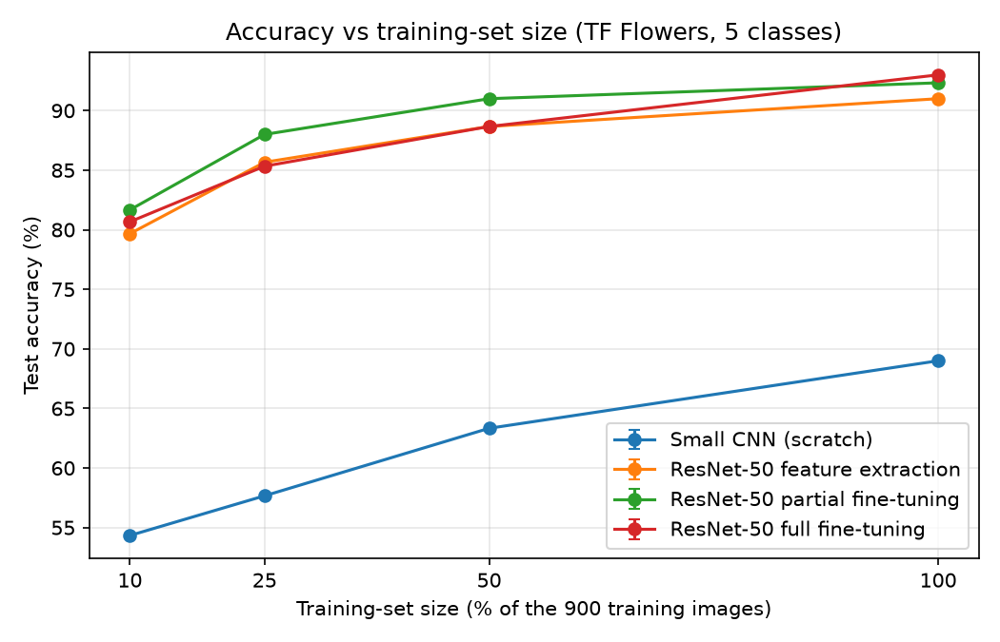

# Transfer Learning Mini-Lab

**CPECOG2 · Deep Neural Networks**

Galvez, Ron John · Gerolaga, Venz · Metrillo, Brian David · Romero, John Mark

## Setup

- **Dataset:** TF Flowers, 5 classes (daisy, dandelion, roses, sunflowers, tulips), 300 images per class.
- **Split:** 900 train, 300 validation, 300 test. The same split is used for every run.
- **Models:** a small CNN from scratch, and ResNet-50 (ImageNet weights) with feature extraction, partial fine-tuning, and full fine-tuning.
- **Seed:** one (0). One test image is 0.33 points, so we count gaps of 2 points or less as ties.

## Results (100% of training data)

| Model | Accuracy | Macro-F1 | Trainable params | Time (s) |
|---|---:|---:|---:|---:|
| Small CNN (scratch) | 0.690 | 0.689 | 94,341 | 106 |
| Feature extraction | 0.910 | 0.910 | 10,245 | 503 |
| Partial fine-tuning | 0.923 | 0.924 | 14,974,981 | 112 |
| Full fine-tuning | 0.930 | 0.930 | 23,518,277 | 270 |

Time is the total training time with early stopping. Feature extraction trains the fewest weights but took the longest, because its small head needed 35 epochs and each epoch still runs the full ResNet-50.

## Accuracy vs Training-Set Size

| Train images | Scratch | Feature extraction | Partial FT | Full FT |
|---|---:|---:|---:|---:|
| 90 (10%) | 0.543 | 0.797* | **0.817** | 0.807 |
| 225 (25%) | 0.577 | 0.857* | **0.880** | 0.853 |
| 450 (50%) | 0.633 | 0.887 | **0.910** | 0.887 |
| 900 (100%) | 0.690 | 0.910 | 0.923 | **0.930** |

\* Still improving slowly when it hit the 40-epoch limit, so slightly underestimated.

## Winning Strategy

Partial fine-tuning won at 25% and 50%. At 10% and 100%, the three ResNet-50 models were within 2 points of each other, so those sizes are ties. Scratch was last at every size, 24 to 30 points behind. ResNet-50 already learned edges, textures, and shapes from ImageNet, and flowers look like ImageNet photos, so those features carry over. The small CNN has to learn them from a few hundred images. Feature extraction can't adapt its frozen features, so it trails partial fine-tuning. Partial fine-tuning lets the top layers adapt to flowers and keeps the rest fixed. Full fine-tuning has 23.5 M weights to fit, which is too many for small data, and it caught up only at 100%. This matches the lecture: with small, similar data, fine-tune only the top layers. With more data, unfreezing more layers starts to pay off.
